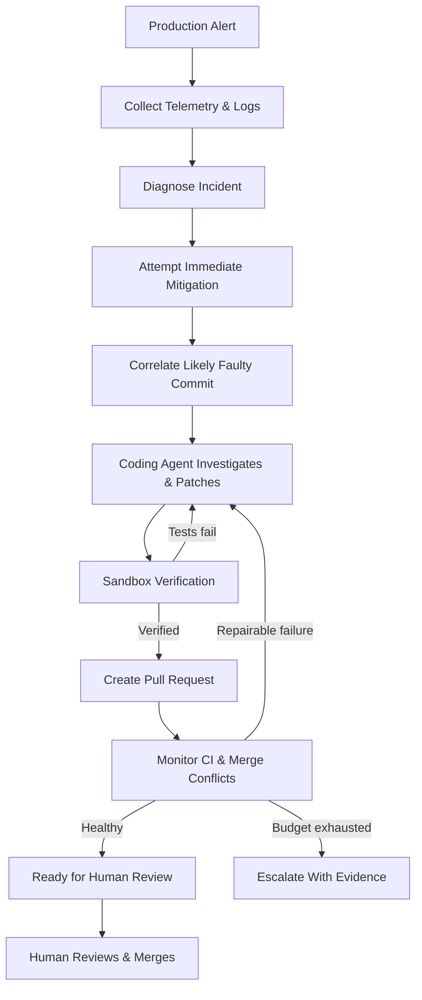

# AutoSRE — Team Zero-Ops

### From production incident to verified fix — autonomously.

🔗 **Live Landing Page:** [https://landing-page-for-auto-sre.vercel.app/](https://landing-page-for-auto-sre.vercel.app/)

AutoSRE is an AI-powered Site Reliability Engineering agent that detects database incidents, mitigates the immediate impact, investigates likely root causes, and uses a coding agent to develop and test a fix in a sandbox. It then opens a pull request and monitors it for failing CI or merge conflicts until it is ready for human review.

**The goal:** reduce the manual work between detecting an incident and delivering a verified, reviewable fix—without handing control of production merges to an AI agent.

> **Human-in-the-loop by design:** AutoSRE can investigate, modify code in its workspace, run tests, and prepare a pull request. A human remains responsible for the final merge.

---

## The problem

Traditional incident response requires engineers to switch between monitoring tools, logs, database diagnostics, Git history, code editors, test runners, and pull requests.

AutoSRE brings these steps into one bounded workflow.

| Traditional response | With AutoSRE |
|---|---|
| Investigate symptoms manually | Correlate telemetry, logs, and Git history |
| Mitigate the incident manually | Attempt a targeted, guarded mitigation |
| Reproduce and debug the issue | Use a coding agent with test feedback |
| Validate the fix manually | Run regression and project test suites |
| Create and maintain a PR manually | Prepare a PR and attempt bounded repair rounds |
| Track the incident across tools | Inspect a unified incident timeline and audit trail |

*AutoSRE assists with incident response; it does not guarantee that every incident can be diagnosed or automatically fixed.*

## How it works



### The two feedback loops

**1. Fix loop**

The coding agent reads relevant files, searches the codebase, edits permitted files, and runs tests. Failed checks provide feedback for another bounded attempt. The fix must satisfy the configured verification requirements before it can finish.

**2. Pull-request repair loop**

After PR creation, AutoSRE can respond to merge conflicts and failing CI within its configured repair budget. If it cannot safely complete the workflow, it escalates the incident rather than continuing indefinitely.

---

## Key capabilities

- **Incident diagnosis:** inspect database telemetry and diagnostic evidence to understand the failure.
- **Immediate mitigation:** attempt to reduce the impact of supported database incidents.
- **Root-cause correlation:** rank likely faulty commits using diagnostic evidence and Git history.
- **Tool-using coding agent:** investigate, search, edit, and test code through guarded tools.
- **Sandbox verification:** check the regression test against the original code and run the project test suite against the patch.
- **Pull-request automation:** prepare a fix and post-mortem, then monitor and attempt bounded PR repairs.
- **Human-controlled delivery:** keep the final merge under human control.
- **Auditable execution:** expose incident timelines, tool calls, diffs, sandbox runs, and audit information.
- **Explicit execution modes:** distinguish live model behavior from cached decisions, replay, fallback, and non-isolated sandbox execution.

## Safety and guardrails

AutoSRE is designed around constrained autonomy rather than unrestricted code execution.

| Guardrail | Intended enforcement |
|---|---|
| Restricted file changes | Limit edits to permitted suspect-commit files and new tests |
| Change-size limit | Enforce the configured maximum of 50 changed source lines |
| Secret protection | Scrub sensitive values before model calls and reject detected secrets in patches |
| Risky-code checks | Inspect proposed additions for configured dangerous patterns |
| Regression verification | Require the regression test to fail on the original code and the full suite to pass on the patch |
| Bounded retries | Limit fix attempts and PR repair rounds |
| Sandbox restrictions | Docker runner uses network restrictions, no host mounts, a non-root user, resource limits, and a timeout |
| Human-controlled merge | Prevent the agent from merging directly into the protected main branch |
| Escalation | Surface unresolved incidents with available evidence |

**Important security limitation:** pattern-based guardrails are not a complete security boundary. Docker isolation applies to the configured Docker execution path. The subprocess fallback is **not isolated** and must not be treated as safe for untrusted code. Installation and image-build commands also require appropriate isolation and trust controls.

## Technology stack

| Component | Technology |
|---|---|
| Backend and REST API | Python, Django 5, Django REST Framework |
| Agent orchestration | LangGraph |
| LLM providers | Groq or NVIDIA Nemotron |
| Frontend | React, TypeScript, Vite |
| Database | PostgreSQL 16 |
| Sandbox | Docker |
| Delivery integrations | Local provider and GitHub integration |
| Incident updates | Server-Sent Events (SSE) |

### Project configuration

Projects can describe their build and test commands in `.autosre.yml`, with automatic detection for Python, Node.js, Go, and Java.

Database integration currently starts with PostgreSQL. Support for a language or project profile should not be interpreted as a guarantee that every framework, database, or incident type is automatically repairable.

---

## Quick start

### Prerequisites

- Python 3.11+
- Git 2.38+
- Node.js 18+
- Docker Desktop, running

### 1. Clone the repository

```bash
git clone https://github.com/shv-codes/zero-ops-autosre.git
cd zero-ops-autosre
```

### 2. Set up the project

```bash
python scripts/setup.py
```

The setup script prepares the Python environment, dependencies, environment configuration, database migrations, demo repository, frontend dependencies, Docker services, and sandbox image.

### 3. Start the application

```bash
python scripts/dev.py
```

Open **http://127.0.0.1:5173** in your browser.

Navigate to **Controls → Start incident** to trigger the demo workflow.

### 4. Run the headless demo

```bash
python scripts/demo.py --conflict --merge
```

This scenario exercises the incident workflow, including pull-request repair and a simulated teammate conflict.

**Docker note:** the application may start without Docker, but the subprocess sandbox fallback is not isolated. Use the Docker-backed sandbox for isolated test execution, and do not use the fallback to run untrusted code.

---

## Live mode: real LLM and GitHub integration

The default local demo and live integration mode serve different purposes.

For live model execution, configure your `.env`:

```dotenv
AUTOSRE_MODE=live
LLM_PROVIDER=groq
GROQ_API_KEY=your_groq_api_key
```

For NVIDIA, configure the corresponding provider and `NVIDIA_API_KEY` instead.

To enable real GitHub pull requests, configure the GitHub delivery provider and credentials:

```dotenv
DELIVERY_PROVIDER=github
GITHUB_REPO=your-user/victim-service
GITHUB_APP_ID=your_github_app_id
GITHUB_APP_PRIVATE_KEY_PATH=secrets/github-app.pem
TARGET_REPO_PATH=var/victim_repo_github
```

Then use **Controls → Connect GitHub**.

Follow the complete setup guide: [`docs/GITHUB_APP_SETUP.md`](docs/GITHUB_APP_SETUP.md).

Keep credentials out of source control. Use the local demo to validate the workflow before enabling live integrations. If the configured LLM is unavailable, AutoSRE may fall back to recorded decisions; such runs should not be presented as successful live-LLM demonstrations.

---

## API overview

The API is exposed under `/api/v1`.

| Endpoint | Purpose |
|---|---|
| `GET /health` | Health check |
| `GET /system` | Configuration and dependency status |
| `POST /alerts` | Receive incident alerts |
| `GET /incidents` | List incidents |
| `GET /incidents/{id}` | Retrieve incident details and timeline |
| `GET /incidents/{id}/stream` | Stream incident updates using SSE |
| `GET /incidents/{id}/diff` | Inspect the proposed code changes |
| `GET /incidents/{id}/postmortem` | Retrieve the incident post-mortem |
| `GET /incidents/{id}/steps` | Inspect agent execution steps |
| `GET /incidents/{id}/sandbox-runs` | Inspect sandbox runs |
| `GET /incidents/{id}/audit` | Download the audit trail |
| `GET /guardrails` | Inspect guardrail status |
| `GET /telemetry/connections` | Inspect database connection telemetry |
| `GET /config` | Read runtime configuration |
| `GET /github/status` | Check GitHub integration status |

Additional configuration, GitHub connection, incident merge, and demo-control endpoints are available in the implementation.

---

## Running tests

Run the backend tests:

```bash
.venv/bin/python -m pytest backend
```

Run the victim-service tests:

```bash
.venv/bin/python -m pytest victim_service
```

On Windows, use `.venv\Scripts\python.exe` instead.

Docker and PostgreSQL integration tests may be skipped when their required services are unavailable. For a meaningful verification run, start the required services and inspect the test output rather than treating skipped tests as passing integration tests.

## Repository structure

```text
zero-ops-autosre/
├── backend/
│   ├── agent/          # Workflow orchestration and coding agent
│   ├── correlation/    # Commit scoring and Git blame
│   ├── diagnostics/    # Diagnosis and mitigation
│   ├── delivery/       # Local and GitHub delivery
│   ├── guardrails/     # Safety and patch checks
│   ├── incidents/      # Incident lifecycle and API
│   ├── sandbox/        # Docker runner and fallback
│   ├── telemetry/      # Database adapters
│   └── workspace/      # Repository and branch operations
├── frontend/           # React + TypeScript dashboard
├── victim_service/     # Demo application and test cases
├── infra/postgres/     # PostgreSQL roles and configuration
├── docs/
│   ├── HOW_IT_WORKS.md
│   ├── IMPLEMENTATION_PLAN.md
│   └── GITHUB_APP_SETUP.md
├── scripts/            # Setup, development, and demo scripts
├── docker-compose.yml
├── .env.example
└── README.md
```

## Documentation & Links

- 🌐 **Live Landing Page:** [https://landing-page-for-auto-sre.vercel.app/](https://landing-page-for-auto-sre.vercel.app/)
- [How AutoSRE works](docs/HOW_IT_WORKS.md)
- [Implementation plan](docs/IMPLEMENTATION_PLAN.md)
- [GitHub App setup](docs/GITHUB_APP_SETUP.md)

## Current scope and limitations

AutoSRE is a hackathon-stage engineering project. Its reliability and security depend on the configured execution environment, project profile, telemetry, LLM provider, permissions, and test quality.

- Automated remediation is limited to incidents and projects the system can diagnose and operate on.
- Commit correlation identifies likely causes; it does not prove causation.
- Passing tests provide evidence of correctness, not a guarantee of defect-free code.
- Regex and pattern-based guardrails cannot identify every dangerous change.
- Non-Docker sandbox execution is not isolated.
- Live LLM behavior, recorded replay, and fallback execution must be evaluated separately.
- Unresolved or unsafe cases should be escalated for human investigation.

## Vision

**Move incident response from alert to verified, reviewable change—with bounded autonomy, explicit evidence, and a human in control.**

Built by **Team Zero-Ops** for the CU Hackathon.
